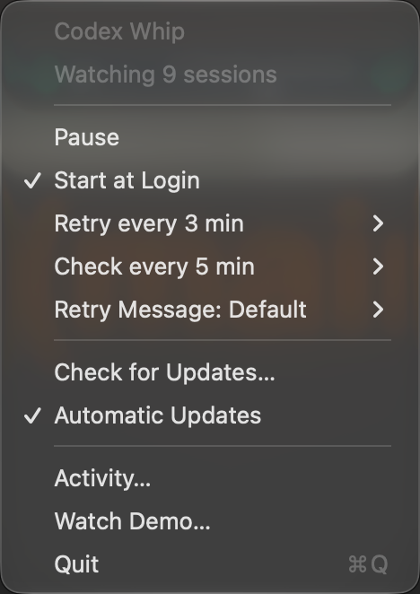

<div align="center">
  
  <h1>Codex Whip</h1>
  <p><strong>Codex stops. Whip doesn't.</strong></p>
  <p>A tiny Mac menu bar app that gets Codex CLI back to work after capacity errors and quota waits.<br>
  Same session. Same model. No babysitting.</p>
  <p>
    <a href="https://github.com/turushan/codex-whip/releases/latest/download/Codex-Whip-arm64.dmg"><strong>Download for Apple silicon</strong></a>
    &nbsp; · &nbsp;
    <a href="https://github.com/turushan/codex-whip/releases/latest/download/Codex-Whip-x86_64.dmg"><strong>Download for Intel</strong></a>
    &nbsp; · &nbsp;
    <a href="https://codexwhip.com"><strong>codexwhip.com</strong></a>
  </p>
  <p>
    <a href="https://github.com/turushan/codex-whip/releases/latest"></a>
    
    
    <a href="LICENSE"></a>
    
  </p>
</div>

<p align="center">
  <a href="docs/demo/codex-whip.mp4">
    <picture>
      <source media="(prefers-reduced-motion: reduce)" srcset="docs/demo/poster.png?v=1.8.0-night">
      
    </picture>
  </a>
</p>
<p align="center"><sub>Illustrated demo · Time compressed · <a href="docs/demo/codex-whip.mp4"><strong>Watch the full film with sound</strong></a></sub></p>

## The 2 AM problem

You leave Codex on a long task. At 2:13 AM it hits **“Selected model is at capacity”** and stops. Or your usage runs out and resets an hour later. Either way, the session sits idle until you come back, and the night is gone.

Codex Whip watches your terminal sessions from the menu bar. When one stops, it waits the right amount of time, then asks **that same session** to continue, with **the same model and settings**. You wake up to finished work.

## How it works

| When Codex… | Whip… |
|---|---|
| stops with a **capacity error** | waits three minutes, checks the session is still idle with the same model, and sends your retry message. It repeats if capacity is still short. |
| runs **out of usage** | checks every five minutes until Codex itself confirms usage is available again for the same account, then continues. Scheduled renewals and early resets both count. |
| starts working again | counts the retry as a success after two minutes of healthy work, or when the turn completes. |

What it never does: switch models, change reasoning effort or permissions, switch accounts, spend reset credits, or guess from percentages. If anything looks different from when the session stopped, it waits instead.

## Built for your menu bar

<p align="center">
  
</p>

- **One glance status.** How many sessions Whip watches, and what it is waiting for.
- **Your pace.** Retry and check intervals right in the menu. Preview, edit or reset the retry message.
- **Hear the whip.** A crack when a retry goes out, and one when the app opens. On by default, one click to turn off.
- **Activity report.** Capacity and quota recoveries for the last 24 hours, counted separately.
- **Stays current.** Start at Login and automatic updates, signed and verified before installing.
- **Watch Demo.** The illustrated film, with sound, right from the menu.

## Install

1. [Download the DMG](https://github.com/turushan/codex-whip/releases/latest) for your Mac and drag **Codex Whip** into **Applications**.
2. Open it. It is signed and notarized by Apple, so it opens like any other Mac app and lives in the menu bar.
3. Use **Codex CLI** as usual. Choose **Start at Login** if you want Whip there every morning.

Or with Homebrew:

```sh
brew install --cask turushan/tap/codex-whip
```

Either way, Whip keeps itself up to date. Defaults: **check every five minutes · retry capacity every three minutes**. Pause any time.

## Private by design

Whip talks only to the Codex daemon on your Mac, over its local socket. Settings and history stay in `~/Library/Application Support/Codex Whip/`. Conversation text and credentials are never stored, and the only network traffic is the update check with GitHub, daily or when you ask. Updates are verified with Apple code signing and an EdDSA key before they install.

<details>
<summary><strong>Build it yourself</strong></summary>

Requires a Mac with Xcode, and Python 3.9+ for the build script.

```sh
git clone https://github.com/turushan/codex-whip.git
cd codex-whip
python3 scripts/build_app.py
```

The universal app and DMG appear in `dist/`, ad hoc signed. The engine is the Swift package in `engine/`; `swift test --package-path engine` runs its tests. Official releases are signed and notarized by the [release workflow](docs/RELEASING.md).

</details>

[How it works in detail](docs/INSTALL.md#what-gets-retried) · [Settings & privacy](docs/INSTALL.md#activity-and-local-files) · [Experimental Desktop connector](docs/DESKTOP.md) · [MIT license](LICENSE)

<sub>Codex Whip is in beta and improving. It is an unofficial companion to Codex CLI and needs its shared local daemon. Model availability still depends on OpenAI.</sub>
