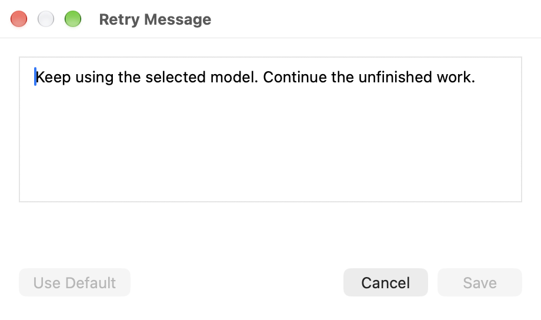

# Installation and troubleshooting

## Install the menu bar app

Download [Codex-Whip-arm64.dmg](https://github.com/turushan/codex-whip/releases/latest/download/Codex-Whip-arm64.dmg),
open it, and copy **Codex Whip.app** into **Applications**. Open the app from there and
eject the DMG. Apple silicon and Intel downloads require macOS 14 or later.
Python is bundled; no separate Python installation is needed to run the app.

The app appears in the menu bar. Open Codex CLI normally, then use the menu to pause or resume
watching, choose **Start at Login**, or open **Activity**. If macOS needs your approval first, the
item reads **Approve Start at Login…** and opens Login Items in System Settings. Quitting the app
stops its helper and leaves any Codex turn already running alone.

With **Whip Sound** on, a short whip crack plays whenever a retry message is sent. It is on for
new installs, cracks once when the app opens and once when you turn it on, and follows your Mac's
volume and mute settings. Scanning, waiting and quitting stay silent. Turn it off at any time;
your choice is saved locally.

Choose **Watch Demo** for an illustrated film of capacity retries, a scheduled quota renewal and an
early reset announcement. The bundled video includes original sound, with native pause, seek, replay,
mute and volume controls. Demo audio starts only when you open the video;
the player retains your mute/volume choices during this app session.

The fictional sessions are labeled as a demo and include explicit compressed waits. The whip and
progressive message entry are illustrative; the real watcher sends the saved message at once.
The reset announcement is an illustrated example: Whip checks Codex quota and does not monitor posts.
The video works offline and sends no Codex messages. Closing stops both streams; reopening starts
from the beginning.


### First launch

Release downloads are signed with a Developer ID certificate and notarized by Apple, so the app
opens like any other Mac app. Versions before 1.10.3 were ad hoc signed; they update to a notarized
version through **Check for Updates…** without any extra step.

### Updating

Release downloads and update feeds are public. No GitHub sign-in is required.

Choose **Check for Updates…** to check GitHub immediately and install an available release.
The app checks quietly once a day. **Automatic Updates**, on by default, enables background downloads,
installation, and automatic relaunch. With it off, a new release appears at the top of the menu with its version,
such as **Update to Version 1.9.0…**. Click it to review and install; nothing downloads until you
choose to install.
Update feeds and archives are verified with the app's embedded Ed25519 public key by Sparkle.

For a manual update, quit the app, replace its copy in Applications, and reopen it.
Your settings and history remain outside the bundle.

Version 1.2.0 needs one manual upgrade: quit it, replace its copy in Applications with the new
release, and open it again. The private state directory sits outside the app bundle, so pending
timers, the retry journal, and activity history remain available through either update method.

The native app manages its own helper process and macOS login item. On startup it removes the
optional CLI service's login job from the default state directory before taking over that worker.
It preserves the saved session scope and state.

### Updating to 1.10

Version 1.10 gives the app its own identifier, `com.turushan.codex-whip`. Settings, pending waits,
the send journal and history stay in `~/Library/Application Support/Codex Whip/` and carry over.
macOS keeps Start at Login and the Automatic Updates choice per identifier, so turn them on again once
from the menu after the update.

## Build from source

Requirements:

- macOS with Xcode command-line tools, including the Swift compiler.
- Python 3.9 or later.
- Internet access for pinned Python dependencies and the checksum-verified Sparkle framework.

From a clone of the repository:

```sh
python3 -m unittest discover -s tests -p 'test_*.py'
python3 scripts/build_app.py
```

The build script manages `.venv-build/`, installs pinned PyInstaller dependencies, and bundles
the engine and Python runtime inside the native app. It produces the app, an architecture-named
DMG, and checksums in `dist/`. An Apple silicon build produces
`dist/Codex-Whip-arm64.dmg`. Build on an Intel Mac to produce an Intel version.

The generated app is ad hoc signed. Building locally does not provide a Developer ID signature
or Apple notarization; the [release guide](RELEASING.md) describes the signed release build.
Source builds use the official release update feeds and public key. They can receive official
updates when a compatible release exists for their architecture. Disable **Automatic Updates**
if you want to manage your build yourself. Building the app requires no private signing key.
Maintainers can use the separate [release guide](RELEASING.md) to publish signed updates.

## Advanced command-line installation

The menu app is the normal installation. The source tree also supports a standalone CLI service.
Quit the native app before starting that service. Use either the app's worker or the CLI service
to manage automatic retries.

From the source checkout:

```sh
python3 codex_whip.py doctor
python3 codex_whip.py start
```

`doctor` reads Codex daemon metadata. It submits no turn or inference request.
`start` installs `~/.local/bin/codex-whip` and a user LaunchAgent that starts at login.
Keep the checkout at its installed path. If `~/.local/bin` is outside your shell's PATH, use the
full command path.

```sh
~/.local/bin/codex-whip status
~/.local/bin/codex-whip report
~/.local/bin/codex-whip report --hours 48
~/.local/bin/codex-whip logs
~/.local/bin/codex-whip stop
```

CLI `start` and `stop` manage the CLI LaunchAgent. Use the native menu controls when the app
owns the worker. A source `report` command can read the same history while the app runs.

A fresh CLI `start` watches capacity failures from that moment forward. To update the source
installation without resetting its activation time, pending timers, or session scope:

```sh
~/.local/bin/codex-whip stop
git pull --ff-only
python3 codex_whip.py start --preserve-state
```

### Restrict the session scope

By default, the helper watches loaded top-level terminal sessions on the shared daemon.
For a CLI installation, select particular session UUIDs:

```sh
python3 codex_whip.py start --thread YOUR-SESSION-UUID
```

Repeat `--thread` to select several sessions. The UUID appears in the Codex thread link or
the `CODEX_THREAD_ID` environment variable inside that session's shell. Stop an existing CLI
installation before changing its scope.

## What gets retried

The helper recognizes a latest failed turn with the `serverOverloaded` error code. It can also
recognize the exact capacity message on versions without that structured code. An `idle` or
`systemError` session can be retried; an active session cannot.

By default, it discovers failures every 300 seconds and waits at least 180 seconds after observing each capacity failure.
Due capacity retries run independently of that five-minute discovery cadence.
Before sending, it rechecks the latest turn, runtime status, model, and reasoning effort.
The existing thread receives a continuation without being resumed or having its settings overridden.
Repeated capacity failures get another wait. A structured `usageLimitExceeded` failure starts a quota wait.
Whip checks quota at the configured check interval and requires Codex's explicit `ordinaryUsageAllowed`
permission for the same observed account. Scheduled renewals and early resets both appear through that
permission check. It never guesses from percentages or a reset timestamp, consumes reset credits, or
uses a reset-tracker service. Unknown status or a changed account keeps the session waiting.

Before a quota continuation, Whip reads permission again and checks the latest failed turn, runtime,
model and reasoning effort. Account permission permits a retry attempt; it cannot guarantee that the
selected model has capacity or a separate model-specific allowance. `rateLimitExceeded`, context
exhaustion, session budgets, authentication and other unsupported errors require normal user action.

Pending retries are cancelled when the session recovers, becomes active, is interrupted,
unloads, or changes model or reasoning effort. Subagents, ephemeral sessions, and unloaded
conversations are excluded. Terminal sessions can retain a `vscode` source after resuming;
the `codex-tui` originator also identifies terminal sessions.

Codex has no atomic operation to submit only while a session remains inactive. A simultaneous
manual message can receive the continuation as steering input between the final check and
submission. Pause the app when you want exclusive manual control.
The protocol also lacks an atomic account-and-turn submission guard. The app rechecks account
permission before sending, but a simultaneous account change can race the final reads.

Each send is journaled before submission. If a connection fails after sending and acceptance is
unknown, that same continuation is not sent again automatically. Inspect the affected session
before continuing it manually.

## Settings

Choose **Retry Every** or **Check Every** directly from the menu. The checked choice is saved
immediately. Defaults are three-minute capacity retries and five-minute checks. Existing custom intervals
also remain visible. Changes apply without restarting Codex or changing the session's model settings.

**Retry Message** previews the saved message. Choose **Edit Message…** for a compact text editor;
**Save** applies the draft and **Cancel** discards it. **Use Default** in the editor fills a draft
that still needs Save. **Use Default Message** in the menu immediately resets only the message,
preserving both intervals.

The default message is “Keep using the selected model. Continue the unfinished work.”
Updates preserve saved custom messages. Choose **Use Default Message** to adopt the current default.



Preferences open locally in Swift without launching the Python helper or fetching anything online.
Settings stay in the private local `settings.json` file. Saving them is atomic. Retry timing changes
recalculate existing capacity waits from their original start time. Check interval changes update
the next quota poll. Active retry turns are observed at least every thirty seconds independently of
discovery checks, so recovery can be confirmed after two observed minutes. Invalid manually edited settings stop scanning with
an explicit error until corrected; the app does not silently discard them.

## Activity and local files

The 24-hour summary counts capacity errors found, retries sent, successful retries, failed retries
(capacity and other errors), interruptions, uncertain sends, and retries awaiting recovery.
Quota recovery has its own corresponding counters. A positive permission check counts as permission
to attempt continuation; success still requires observed healthy work or a completed retry turn.
History retains 48 hours. The output states when recording began if less than a complete window
is available. Recent events name each session by the last eight characters of its ID. The Activity
window shows their times as "Today at 6:38 AM" and reloads whenever it comes to the front.

Accepting a continuation counts as a sent retry. Success requires two minutes of observed healthy
activity on that exact retry turn, or its successful completion sooner. Approval or input waits,
errors, interruptions, pauses, restarts, unloads, and observation gaps do not count toward the two
minutes. A later user turn cannot stand in for the retry. Once recovery succeeds, later task errors
do not undo that recovery; a later capacity failure can start a fresh retry cycle.
Known terminal timestamps place delayed observations in their actual reporting window.
If the retry is outside the most recent 20 turns, it can remain pending or unknown.

Local files live in `~/Library/Application Support/Codex Whip/`:

- `state.json`: saved scope, pending timers, and the send journal.
- `settings.json`: saved retry/check intervals and the continuation message.
- `history.sqlite3`: activity events, with 48-hour retention.
- `worker.log`: diagnostic events, rotated at one MiB with two backups.
- `worker.lock`: the worker's exclusive lock. A stale PID alone does not mean it is running.

Files are restricted to your macOS user and contain session IDs and retry metadata.
Conversation bodies and credentials are not stored. Quota waits retain only a private hash binding
to the observed account in `state.json`; account identity and raw usage responses are excluded from
history and diagnostic events. The optional CLI login job is
`~/Library/LaunchAgents/com.turushan.codex-whip.plist`.
The native app uses its own login item.

## Connection troubleshooting

Open Codex CLI first. The helper expects the shared daemon's local control socket at
`$CODEX_HOME/app-server-control/app-server-control.sock`, with `~/.codex` as the default home.
An older standalone CLI process or `codex --no-daemon` session without this socket is unsupported.
Desktop-only and IDE-only sessions are outside the tool's scope.

The integration was verified with Codex CLI and daemon 0.164.0. Their protocol is experimental.
Older versions that omit explicit ordinary-usage permission leave quota retries waiting with an
unknown status rather than guessing availability. After a Codex upgrade, run the source tree's read-only check:

```sh
python3 codex_whip.py doctor
```

Consult the [official Codex app-server documentation](https://learn.chatgpt.com/docs/app-server)
for the protocol. The helper does not create quota, bypass usage limits, or reserve access to a model.
